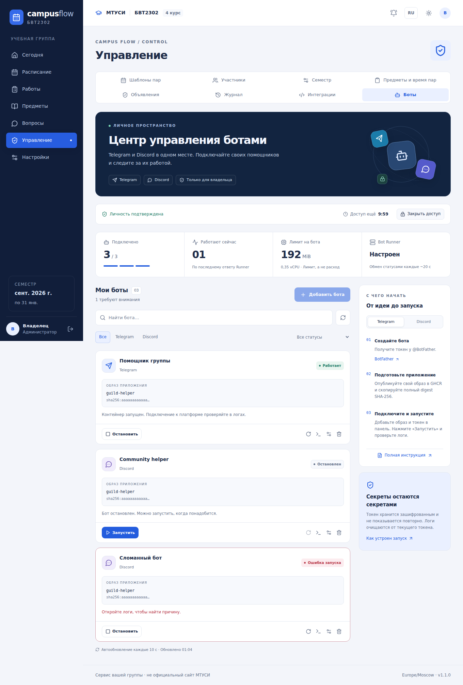
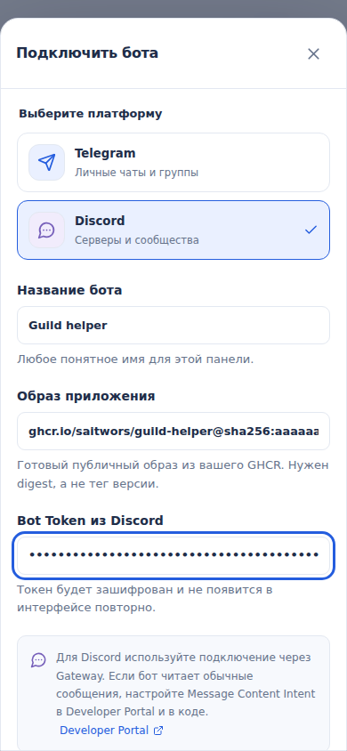

# Private Bot Manager — Telegram и Discord в одной панели

Функция доступна только первоначальному владельцу — аккаунту, зарегистрированному при первичной настройке Campus Flow через setup. Другие администраторы и старосты не получают доступа.

## Что умеет панель

- Существующая TOTP обязательна для владельца; отдельный новый шестизначный код требуется при входе в Bot Manager. Срок доступа 10 минут, сервер проверяет его на каждом API-запросе, токен сессии и CSRF обновляются при повышении прав.
- Telegram и Discord: регистрация, редактирование, запуск, остановка, перезапуск и удаление. Смена платформы требует нового токена.
- Новые карточки, поиск по имени/образу, фильтры платформы и ошибок, отдельная форма настройки и окно логов с копированием.
- Автообновление раз в 10 секунд только в видимой вкладке. Runner обычно опрашивает API раз в 20 секунд, загрузка образа может занять дольше.
- Таймер 10-минутного доступа и кнопка «Закрыть доступ». По истечении панель удаляет из своего состояния список, логи и несохранённый токен, сервер запрещает операции.
- «Работает» означает свежий отчёт о запущенном контейнере, а не подтверждённый вход в Telegram/Discord. При отчёте старше 90 секунд показывается «Нет свежих данных». «Runner настроен» означает наличие конфигурации, а не проверенную доступность службы.
- RAM и vCPU — выделенные лимиты, не измеренное потребление. Общая квота: 3 бота обеих платформ вместе.
- Поддерживаются только проверенные опубликованные OCI-образы из GHCR личного аккаунта saitwors, по неизменяемому digest SHA-256. Чужие registry, теги вроде latest, загрузка ZIP и команды shell не допускаются.
- Не более 3 ботов. На каждый 192 MiB RAM, 0,35 CPU, 64 PID, non-root UID 10001, read-only rootfs, tmpfs для /tmp, отсутствие privileged/capabilities, без монтирования хостовых каталогов и без доступа к приватным сетям Campus Flow.
- Токен выбранной платформы записывается в зашифрованное поле БД (ключ зависит от существующего INTERNAL_TOKEN). Токен не возвращается через интерфейс.
- Docker socket не передаётся вебу или auth API. Отдельный системный Bot Runner, устанавливаемый вручную на VPS, ограниченно управляет своими контейнерами по меткам.

## Ограничения и риски

Docker не является абсолютной границей безопасности для заведомо вредоносного кода. Запускайте только собственные проверенные образы; доступ root/Docker на хосте позволяет читать переменные окружения в контейнерах. Runner запускается с полномочиями Docker, поэтому его системный конфиг и 256-битный ключ хранятся только на сервере (0600).

Пока нет WebAuthn/Passkeys, OAuth, ZIP-загрузки, автоматического деплоя из GitHub push, поддержки приватного GHCR и постоянных томов для ботов. Бот читает токен из BOT_TOKEN (совместимость), TELEGRAM_BOT_TOKEN для Telegram или DISCORD_TOKEN для Discord, работать без записи в корневую файловую систему и без прав root. Для webhook-проектов понадобится отдельная настройка; поддерживаемые способы — Telegram long polling и Discord Gateway, без публикации входящего HTTP-порта.

Если Runner не работает, ранее запущенные контейнеры могут продолжать работать. Для аварийной остановки всех управляемых ботов вручную:
    docker ps -q --filter label=campus-flow.bot-managed=true | xargs -r docker stop

Удаление бота удаляет его контейнер при следующем успешном опросе runner (20 секунд). Токены нельзя восстановить из зашифрованной БД при утрате прежнего INTERNAL_TOKEN.

## Как готовить собственный бот

На компьютере пишете Python-бота с aiogram или python-telegram-bot. Библиотеки перечисляете в requirements.txt, токен читаете из os.environ["BOT_TOKEN"]. Пример Dockerfile:

    FROM python:3.12-slim
    WORKDIR /app
    COPY requirements.txt /app/
    RUN pip install --no-cache-dir -r requirements.txt
    COPY bot.py /app/
    ENV PYTHONDONTWRITEBYTECODE=1 PYTHONUNBUFFERED=1
    CMD ["python", "-u", "/app/bot.py"]

На отдельном GitHub-репозитории создаёте GitHub Actions сборку Docker и публикацию в ghcr.io/saitwors/<имя>. Используйте GitHub Actions packages: write и docker/build-push-action. После публикации используйте в панели digest из build-push-action: ghcr.io/saitwors/<имя>@sha256:<64 hex>.

Официальный пример: https://docs.github.com/en/actions/tutorials/publish-packages/publish-docker-images

## После merge PR — активация в production

На VPS уже работает /opt/campus-flow/compose.production.yaml. Никогда не используйте docker compose down -v: тома содержат данные одногруппников.

1. Дождитесь успешной публикации новых Campus Flow API и web SHA-образов после merge в main.
2. Обновите чистый рабочий checkout в /opt/campus-flow до origin/main.
3. Выполните: bash scripts/install_bot_runner.sh prepare. Команда создаёт BOT_RUNNER_TOKEN при его отсутствии, сохраняет существующий корректный ключ и записывает его в .env.production и /etc/campus-flow-bot-runner.env (права 0600), но пока не запускает systemd runner.
4. Выполните: bash scripts/deploy_production.sh --image-tag <полный SHA main>. Штатный deploy делает резервирование данных, сверяет образы и применяет миграцию auth schema 5.
5. После успешного обновления: bash scripts/install_bot_runner.sh start.
6. Откройте Campus Flow -> Настройки -> Безопасность, включите TOTP, сохраните резервные коды. Управление -> Боты -> свежий шестизначный код -> выберите Telegram или Discord, добавьте образ и токен выбранной платформы.

Диагностика:
    systemctl status campus-flow-bot-runner --no-pager
    journalctl -u campus-flow-bot-runner --since '10 minutes ago' --no-pager
    docker stats --no-stream
    vmstat 1 10
    df -h /

Проверка production: bash scripts/check_timeweb40_budget.sh

ВНИМАНИЕ: после миграции auth 4 → auth 5 простой откат на старый образ не поддерживается; для отката необходимо восстановить совместимую согласованную резервную копию. Старые значения INTERNAL_TOKEN и SETUP_KEY не должны изменяться.

Техническая структура: services/auth/bots.py и models.py (права, токены, schema 5), BotManager.tsx (панель), scripts/bot_runner.py (ограниченный исполнитель), infra/campus-flow-bot-runner.service (локальный systemd). Сам Campus Flow остаётся в существующих пяти production-контейнерах.


## Discord: подключение готового бота

1. В https://discord.com/developers/applications создайте приложение → Bot. Скопируйте Bot Token. В панель нужен именно токен бота, а не Client Secret/OAuth-токен.
2. В Installation/OAuth2 настройте установку на сервер с областями `bot` и `applications.commands`, выдайте необходимые права и пригласите бота.
3. В образе читайте `os.environ["DISCORD_TOKEN"]`. `BOT_TOKEN` также передаётся для совместимости. Runner не добавляет префикс `Bot `.
4. Выберите Discord при добавлении в Campus Flow, укажите имя, готовый публичный GHCR-образ с полным digest и токен. Нажмите «Запустить»; затем откройте логи.
5. Для ботов на обычных сообщениях настройте Message Content Intent в Developer Portal и в коде. Slash-командам такой доступ к сообщениям обычно не требуется. Политики и лимиты Discord могут меняться; актуальные документы: https://discord.com/developers/docs/events/gateway#privileged-intents

Минимальный пример приложения на `discord.py` со slash-командой `/ping`:

```python
import os
import discord
from discord import app_commands

class Client(discord.Client):
    def __init__(self):
        super().__init__(intents=discord.Intents.default())
        self.tree = app_commands.CommandTree(self)

    async def setup_hook(self):
        await self.tree.sync()

client = Client()

@client.tree.command(name="ping", description="Проверить связь с ботом")
async def ping(interaction: discord.Interaction):
    await interaction.response.send_message("Pong!", ephemeral=True)

@client.event
async def on_ready():
    print(f"Connected as {client.user}", flush=True)

client.run(os.environ["DISCORD_TOKEN"])
```

Зависимость `discord.py` входит в requirements.txt **вашего бота**, не Campus Flow. Соберите и проверьте собственный образ, зафиксировав версию зависимости. Глобальная регистрация slash-команд может появляться с задержкой. Музыкальные боты с voice/FFmpeg, крупные ИИ-модели и постоянное файловое хранилище в эти лимиты не входят.

## Обновление уже установленного Runner

После merge дождитесь зелёного CI и публикации API/Web-образов для полного SHA. Обновите `/opt/campus-flow` до этого SHA, выполните штатный deploy и перезапустите Runner:

```bash
cd /opt/campus-flow
# Checkout должен уже содержать слитый main с нужным SHA.
bash scripts/deploy_production.sh --image-tag <ПОЛНЫЙ_SHA_MAIN>
bash scripts/install_bot_runner.sh start
```

Для первого подключения Runner сначала нужен `bash scripts/install_bot_runner.sh prepare`, как описано выше. Он сохраняет уже существующий ключ, если тот корректен. После обновления проверьте статус службы и логи. Одного обновления web/API для Discord недостаточно: исполняемый Python-процесс Runner должен перечитать новый код.

Миграция auth 4 → 5 добавляет только `platform` с Telegram по умолчанию: существующие боты, токены и сеансы сохраняются. Новый образ и deploy-метаданные ожидают auth5/schedule5/notifications3. Старый auth4-код не запускается на новой схеме без восстановления соответствующей резервной копии.

При смене токена очищаются сохранённые логи и ошибки. Отчёты прежней revision не принимаются; изменение настройки и запись отчёта сериализованы в БД. Остановленный контейнер старой revision удаляется без чтения его старых логов, чтобы прежний токен не попал обратно в диагностику.


## Скриншоты интерфейса

Примеры на тестовых данных, без реальных токенов и запущенных ботов:




